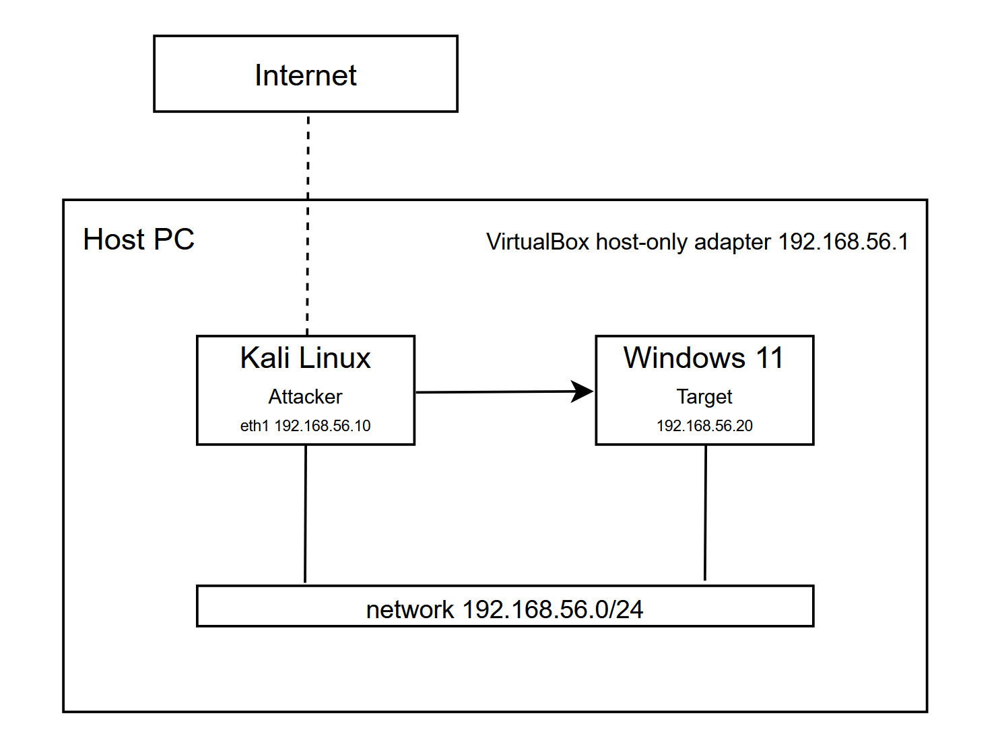

# CyberLab

A small cybersecurity lab I built at home on two virtual machines. Each Scenario in it is an attack I carried out in the lab and then caught from the logs it left behind.




## Scenarios

| #   | Scenario                 | What happens                                                                                           | Status      |
| --- | ------------------------ | ------------------------------------------------------------------------------------------------------ | ----------- |
| 01  | SMB brute force          | Kali guesses the password of a weak Windows account over SMB, logs in and reads a file from a share.   | Done        |
| 02  | Persistence              | Kali runs commands on the target that enumerates the VM and plants persistence that survives a reboot. | In progress |
| 03  | Man-in-the-middle attack | Kali puts itself between target and the host to sniff traffic and pull out sensitive information.      | Planned     |


## The lab

Kali Linux (attacker) and Windows 11 (target) run in VirtualBox on an isolated host-only network, `192.168.56.0/24`. The Windows VM has no route out of the network. Details are in [lab/README.md](lab/README.md).

## Repository layout

```
lab/                    the virtual machines, network and setup 
docs/                   design decisions
CONTEXT.md              the vocabulary of the project
```

## Scope and ethics

Everything here runs only on virtual machines I own, on a network that can't reach anything else. The passwords and sensitive files in this repo are made up for the lab.
