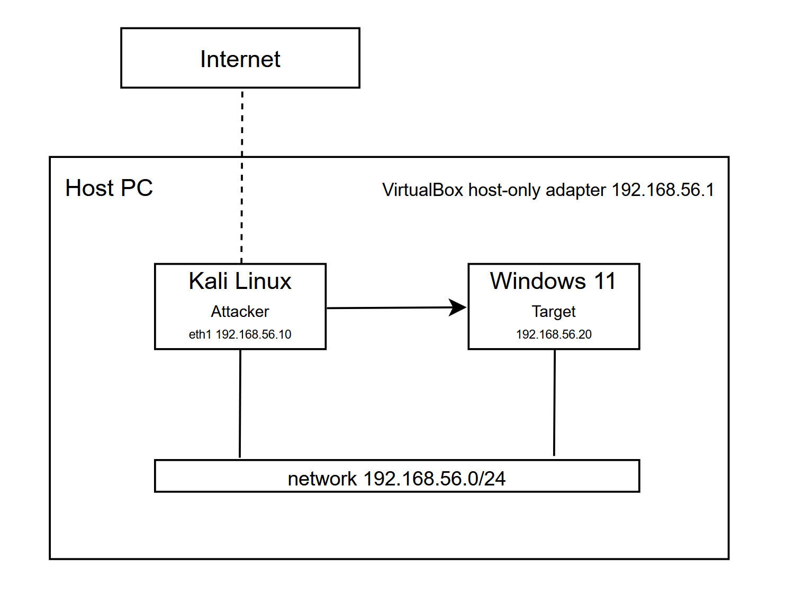

# The lab

| VM | Role | Network adapters | IP on the lab network | Memory |
|---|---|---|---|---|
| Kali Linux | attacker | 1: NAT (internet, for updates) 2: host-only | `192.168.56.10` | 4 GB |
| Windows 11 | target | 1: host-only | `192.168.56.20` | 4 GB |

VirtualBox Version 7.2.22 r175245, Kali Linux version 2026.3 and Windows 11 version 25H2 are used in the lab.

The host-only network is `192.168.56.0/24`. The Windows VM has no gateway, so it can only reach Kali and the host. The Windows VM has no route to the internet. Kali reaches the internet through its NAT adapter, but lab traffic stays on the host-only one.

## Network setup

Kali has two adapters, NAT for updates and a host-only adapter at 192.168.56.10. Windows has a host-only adapter at 192.168.56.20. I checked the isolation of the lab by pinging 192.168.56.10 from Windows, which worked, and 1.1.1.1 which failed. Kali first couldn't ping Windows because Windows Firewall was dropping ICMP by default. I added a rule that allows pinging from 192.168.56.0/24 only. After that the pinging from Kali to Windows worked.

## Turning Windows Lab into the target

[`Setup-Target.ps1`](setup/Setup-Target.ps1) builds the Scenario 01 target from a clean Windows install. The script was written with the help of AI assistant Claude to help understand the concepts better. It was then run and tested. 

The script sets up the following:
- Computer name `WIN11-TARGET`
- a local account (`svc_backup`)
- a share with a planted file
- firewall rules that allow SMB and ping only from the lab subnet
- the audit policies the Detection needs like logon, lockout, file share access

The script also refuses to run on a machine that has a default gateway, as a last check that it isn't pointed at a real computer.

The script reports the lockout threshold of 10 attempts, and the SMB login delay of 2000 ms. Snapshot named `vulnerable` was taken after running the script.
