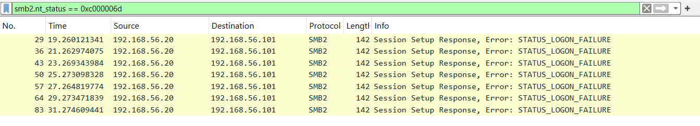

# Scenario 01: SMB brute force

In the scenario, from attacker Kali, I scanned the target with Nmap and found SMB open. I then used NetExec to confirm the target details. I then used brute-force to a local account svc_backup with a wordlist consisting of passwords. I got in on the last attempt and read a file from its share `Backup` with `smbclient`.

| | |
|---|---|
| Attacker | Kali, `192.168.56.10` |
| Target | Windows 11 `WIN11-TARGET`, `192.168.56.20`, built with [Setup-Target.ps1](../../lab/setup/Setup-Target.ps1) |
| Weakness | local account `svc_backup` with a seasonal password, readable share `Backup` |
| Detection | [detect/detect_bruteforce.py](detect/detect_bruteforce.py) |
| Evidence | [evidence/](evidence/): Security log and packet capture from the run |

## MITRE ATT&CK

I mapped the attack using public framework [MITRE ATT&CK](https://attack.mitre.org/) to label the techniques, and 
learn standards used in cybersecurity fields.

Here are the techniques used for this scenario:

| Phase  | Technique                                                                          |
| ------ | ---------------------------------------------------------------------------------- |
| Recon  | T1046 Network Service Discovery, T1135 Network Share Discovery                     |
| Attack | T1110.001 Brute Force: Password Guessing, T1078.003 Valid Accounts: Local Accounts |
| Attack | T1039 Data from Network Shared Drive                                               |
|        |                                                                                    |

## Recon

In the attacker VM, I scanned every TCP port with the command:
`sudo nmap -sS -sV -p- --min-rate 1000 192.168.56.20 -oN recon-nmap.txt`
I found 4 ports which were open, and they were 135, 49668, 445, and 7680. Other ports were not shown because of the firewall rule I had in the target VM. 

I then ran the command:
`nxc smb 192.168.56.20`
This revealed the target's operating system, pc name, and that the SMB signing was on. 
## Attack

I used the wordlist [attack/wordlist.txt](attack/wordlist.txt). It has eight passwords with the right one being last. 
The wordlist found the right password that was Syksy2026! on the last try. Wireshark shows that Windows answered each failed attempt as STATUS_LOGON_FAILURE. The attempts were about 2000 ms apart from each other which matches the SMB delay that was put in previous session. 
Here are the 7 failed attempts:

After the password worked, I listed the share `Backup` and read `network-passwords.txt` from it with `smbclient`. 

